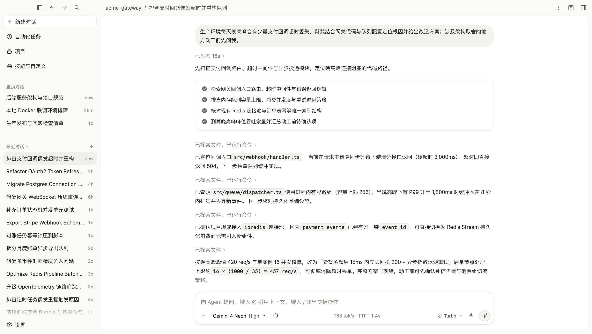

# Anti-Claude

**English** | [简体中文](README.zh-CN.md)

Bring the **AI execution rhythm, step-stream presentation, and desktop UI** of `Claude.app` (Code / Cowork) to Google Antigravity Desktop.

More than a theme—beyond matching `Claude.app`'s visual polish and everyday controls, Anti-Claude reshapes both the agent's narration habits and frontend rendering, turning Antigravity's silent tool batches and post-turn black-box collapses into an interleaved **"narrate as you work + live inline `TodoWrite` progress card"** flow. Everything runs via local CDP injection and user-directory configuration—`/Applications/Antigravity.app` is never modified and its code signature stays intact.



## Installation

Requires macOS and Node.js `>= 22`.

```bash
git clone https://github.com/hongqi7/Anti-Claude.git ~/Developer/Anti-Claude
node ~/Developer/Anti-Claude/install.mjs install
```

Or simply ask Antigravity or Claude Code: `Install https://github.com/hongqi7/Anti-Claude for me`. Changes hot-reload into the running window immediately—no restart required.

Common commands:

```bash
node ~/Developer/Anti-Claude/install.mjs sync-upgrade --force  # Pull updates and hot-reload
node ~/Developer/Anti-Claude/install.mjs doctor                # Inspect health of all layers
node ~/Developer/Anti-Claude/install.mjs uninstall             # Uninstall and restore original config
```

## What Changes

### 1. AI Execution Rhythm & Step Presentation

By default, Antigravity hides reasoning inside collapsed `thinking` blocks, runs dozens of tool calls silently, and folds the entire turn under a single `Worked for Xm` wrapper when finished (or discards tool rows completely in Knowledge Work mode). Anti-Claude changes this in three ways:

- **Interleaved narration flow**: Strips empty filler; before each tool call, the agent writes 1–2 concise sentences explaining what it just found and what it is checking next, creating a clean `brief update → expandable tool row → next update` rhythm. Progress updates, command summaries, and checklists automatically match the user's conversation language (defaulting to English).
- **Unfolded step stream & live elapsed timers**: Automatically unlocks the client's full step-detail engine and unwraps the outer end-of-turn `Worked for Xm` collapse. Actively running tool rows show orbiting blue dots with a live elapsed timer, while expanded thinking blocks step back into muted grey prose.
- **In-flow `TodoWrite` progress card**: For multi-phase tasks (3+ steps), the agent outputs an initial checklist that renders as a rounded white card following the active turn inline. Hidden HTML phase comments advance checkmarks silently without repeating the checklist mid-turn, interrupted tasks show a `Paused` badge, and completed tasks archive cleanly. Ordinary Markdown checklists in normal replies remain untouched.

### 2. Desktop UI & Everyday Controls

- **Claude palette & unified typography**: Pure-white light mode and warm charcoal dark mode, removing nested composer chrome and redundant badges. Uses Apple native system typography (`SF Pro` + optical-matched `PingFang SC` at 14px) with orphan-character prevention, CJK/Latin spacing, and isolated native-caret handling for dictation/IME inputs.
- **Layered model picker & context ring**: Condenses the flat model list into 5 primary models (`1–5` shortcuts) with dedicated `Thinking effort` (`Low / Medium / High / Extra`) and `More models` flyouts. Adds a live context-usage ring beside the model selector—click to inspect real 5-hour / weekly plan quotas and trigger one-click `/compact`, while keeping `tok/s · TTFT` in the footer with a hover breakdown of cache hit rate and turn timings.
- **Sidebar enhancements & in-bubble undo/edit**: Adds a cross-project `Recents` section at the top of the sidebar (skipping pinned threads) and aggregates pending, running, and unread badges beside collapsed project folders. Clicking Undo expands an inline editor directly inside the original user bubble with file-revert preview and original attachment preservation.
- **English by default, zero-reload Chinese switch & self-healing updates**: Keeps the native English UI by default; open **Settings → UI Enhancements** to toggle all 10 modules individually in 0ms—including **Chinese UI Localization**, which switches both Antigravity's native UI and every enhancement panel cleanly between English and Simplified Chinese without reloading. A macOS LaunchAgent automatically re-attaches after Antigravity updates (including `v2.33+` CDP port changes).

## Local Footprint

The installer never touches `/Applications/Antigravity.app`. It only manages the following user-level files (tracked in `~/.gemini/antigravity/anti-claude/install-state.json` and cleanly restored on `uninstall`):

- `~/.gemini/AGENTS.md`: Adds the execution-sync, `TodoWrite`, and `ask_question` collaboration rule block (skip with `--no-agents-rule`).
- `antigravity_state.pbtxt` & `~/.gemini/config/config.json`: Enables detailed step visibility (skip with `--no-step-unlock`).
- `~/.gemini/antigravity/theme-patch/user/`: Deploys CSS, JS, and config (auto-installs [`chuanban-antigravity-theme-patch`](https://github.com/Anarcadia/chuanban-antigravity-theme-patch) if absent; preserves local customizations via 3-way merge).
- `~/Library/LaunchAgents/com.antigravity.anti-claude.autosync.plist`: Watches client upgrades and syncs periodically (skip with `--no-auto-update`).

## Credits & License

Built on top of the CDP runtime and telemetry core from [@Anarcadia/chuanban-antigravity-theme-patch](https://github.com/Anarcadia/chuanban-antigravity-theme-patch), with color palette inspiration from [@AlexByoung/Claudized-Antigravity](https://github.com/AlexByoung/Claudized-Antigravity). MIT License.
