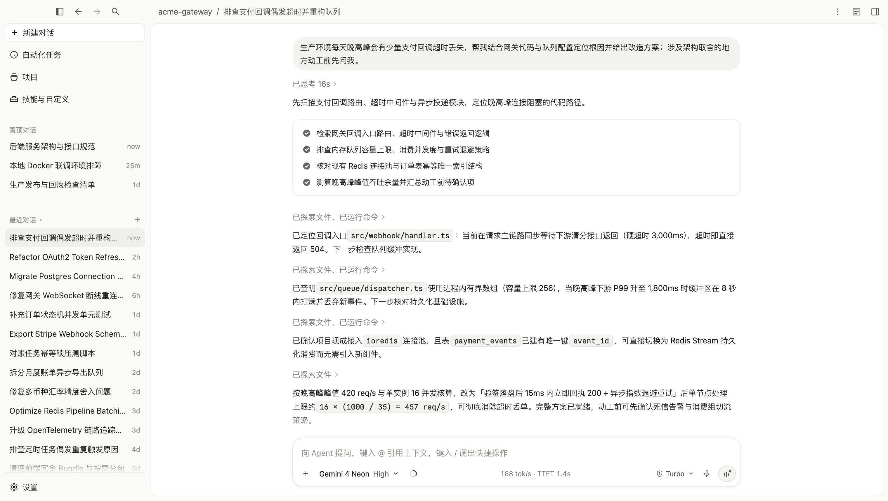

# Anti-Claude

[English](README.md) | **简体中文**

让 Google Antigravity 桌面端拥有接近 `Claude.app`（Code / Cowork）风格的 **AI 回答节奏、过程呈现形式与界面交互**。

它不只是一套界面样式——除了优化视觉排版与高频控件，还同时改写了 Agent 的输出习惯与前端渲染逻辑：把原生「闷头调工具、跑完折叠成黑盒」改成「边做边汇报 + 流内实时进度卡片」。全程通过本地 CDP 注入与用户目录配置实现，不改 `Antigravity.app` 安装包，不破签名。



## 安装

需要 macOS 与 Node.js `>= 22`。

```bash
git clone https://github.com/hongqi7/Anti-Claude.git ~/Developer/Anti-Claude
node ~/Developer/Anti-Claude/install.mjs install
```

也可以直接发给 Antigravity 或 Claude Code：`帮我安装 https://github.com/hongqi7/Anti-Claude`。装完当前窗口直接热生效，不用重启客户端。

常用命令：

```bash
node ~/Developer/Anti-Claude/install.mjs sync-upgrade --force  # 拉取更新并热重载
node ~/Developer/Anti-Claude/install.mjs doctor                # 检查各层状态
node ~/Developer/Anti-Claude/install.mjs uninstall             # 卸载并还原原配置
```

## 改了什么

### 1. AI 的回答方式与执行呈现

原生 Antigravity 默认把推理藏在 `thinking` 里不说话，连跑十几个工具也不吭声，回合一结束还把整轮步骤收进「已工作 Xm」（知识工作模式下工具记录跑完直接销毁）。本项目把这套黑盒流程改成了三件事：

- **边做边汇报的叙事流**：去掉空洞客套话，AI 每次调工具前先用一两句短话讲清「刚查到什么、下一步干什么」，进展汇报、命令摘要与任务清单自动跟随你的对话语言（默认英文），形成「一句进展 → 一行可展开工具摘要 → 下一句进展」的节奏。
- **完整步骤平铺与实时读秒**：自动解锁客户端隐藏的完整步骤引擎，拆掉回合末的「已工作 Xm」外层二次折叠；正在执行的工具行显示蓝色旋转点与读秒，思考展开区退为次级灰字，主次分明。
- **流内跟随的 `TodoWrite` 任务卡片**：遇到 3 步以上的复杂任务，AI 开场列出任务清单，前端在消息流内渲染圆角白卡并紧跟最新步骤滚动；中途靠隐形注释推进打勾（不在正文里重复刷清单），被打断时标「已暂停」，全部完成后自动归档。普通回答里的 Markdown 列表原样保留，不会被误接管。

### 2. 客户端界面与高频交互

- **配色与双栏统一排版**：浅色纯白、深色暖炭灰，去掉双层套娃输入框与多余角标；全局统一苹果原生系统字体（`SF Pro` + `PingFang SC` 中文 `95.5%` 字面微缩，14px），正文与气泡防段尾单字孤行并开启连续全角标点挤压，左右双栏统一 `1/8` 字宽原生留白与 `zh-CN` 避头尾禁则。
- **分层模型菜单与额度圆环**：把平铺的模型菜单收成 5 个常用主力模型（数字键 `1–5` 秒切），「思考强度」（`Low / Medium / High / Extra`）和「更多模型」拆入二级菜单。模型旁增加上下文占用圆环，点开查看 5 小时 / 每周套餐额度、一键压缩当前上下文并实时同步压缩状态；底栏保留 `tok/s · TTFT`，悬停查看缓存命中率与分项耗时。
- **侧边栏增强与气泡内撤回重编**：侧边栏顶部增加跨项目的「最近对话」（自动跳过已置顶会话），折叠的项目文件夹右侧汇总待确认、运行中、未读角标。点击消息「撤回」时直接在原气泡内展开编辑框修改重发，可选是否同步回滚代码改动。
- **默认英文、实时汉化开关与升级自愈**：项目默认保持英文原版界面；在客户端「Settings → UI Enhancements（设置 → 界面增强）」内可单独开关全部 10 项模块（含「中文界面汉化」免重启实时切换，原生界面与所有增强面板同步切中/英文）。macOS 下后台自动跟随客户端升级重挂注入（兼容 `v2.33+` 移除默认调试端口的改动）。

## 本机改动范围

安装器不触碰 `/Applications/Antigravity.app`，仅修改以下用户层文件（全部记录在 `~/.gemini/antigravity/anti-claude/install-state.json`，执行 `uninstall` 逐项还原）：

- `~/.gemini/AGENTS.md`：写入「边做边汇报 + 隐形进度标记 + 交互式选择卡」协作规则（可用 `--no-agents-rule` 跳过）。
- `antigravity_state.pbtxt` 与 `~/.gemini/config/config.json`：开启完整步骤详情展示（可用 `--no-step-unlock` 跳过）。
- `~/.gemini/antigravity/theme-patch/user/`：写入样式、脚本与配置（未装 [`chuanban-antigravity-theme-patch`](https://github.com/Anarcadia/chuanban-antigravity-theme-patch) 时自动拉取；手动改过的本地文件升级时不覆盖）。
- `~/Library/LaunchAgents/com.antigravity.anti-claude.autosync.plist`：监听客户端升级并定期同步（可用 `--no-auto-update` 跳过）。

## 致谢与许可

底层 CDP 注入与汉化遥测内核基于 [@Anarcadia/chuanban-antigravity-theme-patch](https://github.com/Anarcadia/chuanban-antigravity-theme-patch)，部分配色思路参考了 [@AlexByoung/Claudized-Antigravity](https://github.com/AlexByoung/Claudized-Antigravity)。MIT License。
